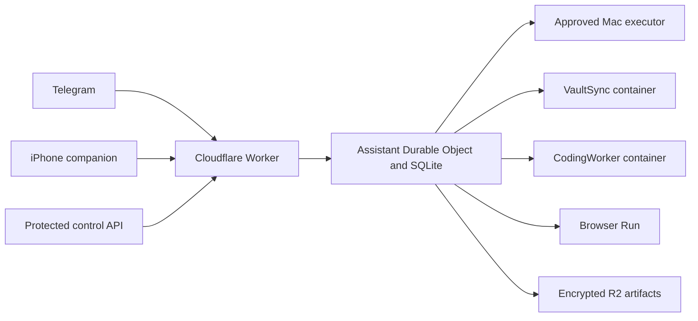

# Umpi

Umpi is a durable, single-owner personal assistant built on Cloudflare Workers, SQLite-backed Durable Objects, Pi Durable, Telegram, and an optional native iPhone companion. It keeps coordination in the cloud, prefers explicitly approved execution on a trusted Mac, and can use isolated cloud workers for bounded coding, browser, and vault tasks.

This repository is a reference implementation for personal operation. It is not a hosted service, multi-tenant agent platform, or one-click secure deployment.

## Capabilities

| Area | Implemented behavior |
| --- | --- |
| Conversation | Persistent Pi conversations through Telegram or a protected control API, with text replies and subscription-backed voice-note transcription |
| Follow-through | Durable reminders, a lightweight 15-minute review cadence, custom wake-ups, quiet hours, and explicit pause/resume controls |
| Execution | Version-bound Mac command approval, private-copy coding on macOS, and separately approved source-only cloud coding |
| Planning and memory | Reviewable and reversible core context, dated owner briefs, read-only Google Calendar input, and scoped Obsidian daily-note updates |
| Browser | A native Aside lane plus encrypted, one-way, site-scoped snapshots for isolated Cloudflare Browser Run tasks |
| Delegation | Durable background assistant and coding subagents with bounded tools, deadlines, and parent-owned integration |
| Phone companion | Native SwiftUI workflows, protected actions, notifications, AlarmKit alarms, and task Live Activities |

General live calls are intentionally not implemented. Browser session portability is site-specific. Native execution is not a filesystem sandbox, and cloud execution never silently takes over work with an uncertain Mac owner.

## Architecture



The Worker exposes public informational pages at `/`, `/privacy`, and `/terms`. Assistant state and control routes remain authenticated.

## Requirements

- Node.js 24 or later.
- A ChatGPT account that can complete the configured OAuth flow.
- Docker for container builds and the full build dry run.
- macOS for the native executor and Aside integration.
- A Cloudflare Workers Paid account for a hosted installation that uses Durable Objects, Containers, R2, or Browser Run.
- A Telegram bot for the primary hosted chat interface.
- Optional: Obsidian Sync for daily-note integration and Xcode/XcodeGen for the iPhone companion.

Provider subscriptions, Cloudflare resources, Telegram, Obsidian, Apple, and other integrations retain their own limits and costs.

## Local start

Install the pinned dependencies and create isolated local configuration:

```sh
npm ci
npm run setup -- local --workspace "$PWD"
```

Complete the independent model login:

```sh
npm run auth -- login openai
```

Start the local coordinator, hand off the credential once, and then start the Mac executor:

```sh
npm run dev
npm run auth -- sync http://127.0.0.1:8787 openai
npm run mac -- run
```

Run those commands in separate terminals where necessary. Setup creates owner-only files, refuses to replace an existing installation, and does not deploy or register a bot. The complete [development and operation runbook](docs/runbooks/local-development.md) covers Telegram, hosted deployment, coding, browser access, vault sync, native signing, and recovery.

## Private configuration

Never commit a live `.dev.vars`, `wrangler.local.jsonc`, signing override, provider credential, bot identity, account ID, device token, browser snapshot, or deployment origin.

The public `wrangler.jsonc` is a local/dry-run template. For a hosted installation, copy it to ignored `wrangler.local.jsonc`, choose unique Worker and R2 resource names, add the private account/domain settings, and keep shared bindings and migrations aligned. See [hosted operation](docs/runbooks/local-development.md#hosted-operation).

Security reports belong in [SECURITY.md](SECURITY.md). The repository's publication and maintenance rules are in [AGENTS.md](AGENTS.md).

## Documentation

| Question | Authoritative page |
| --- | --- |
| System boundaries, runtime choices, and costs | [Architecture](docs/architecture.md) |
| Coordinator, Telegram, scheduling, memory, coding, and API contracts | [Assistant runtime](docs/subsystems/assistant-runtime.md) |
| Native execution and crash recovery | [Mac executor](docs/subsystems/mac-executor.md) |
| OAuth credentials and refresh ownership | [Model authentication](docs/subsystems/model-auth.md) |
| Browser access and authentication snapshots | [Browser access](docs/subsystems/browser-access.md) |
| Native iPhone behavior | [Phone companion](docs/subsystems/phone-companion.md) |
| Interaction and response-quality requirements | [Interaction quality](docs/concepts/interaction-quality.md) |
| Setup, operation, deployment, and recovery | [Development and operation](docs/runbooks/local-development.md) |
| Exercised behavior and remaining limits | [Verification evidence](docs/learning/assistant-core-verification.md) |
| Documentation structure | [Documentation taxonomy](docs/TAXONOMY.md) |

## Development

Use the checked-in lockfiles. After integration, run:

```sh
npm run typecheck
npm test
npm run build
```

`npm run build` is a Wrangler dry run, not a deployment. Behavioral changes also require a real changed-path smoke.

## License

Project-authored source and documentation are available under the [MIT License](LICENSE). Third-party data and dependencies retain separate terms. In particular, the Public Suffix List files remain MPL-2.0, and the optional `obsidian-headless` package declares itself `UNLICENSED`. See [third-party notices](THIRD_PARTY_NOTICES.md).
